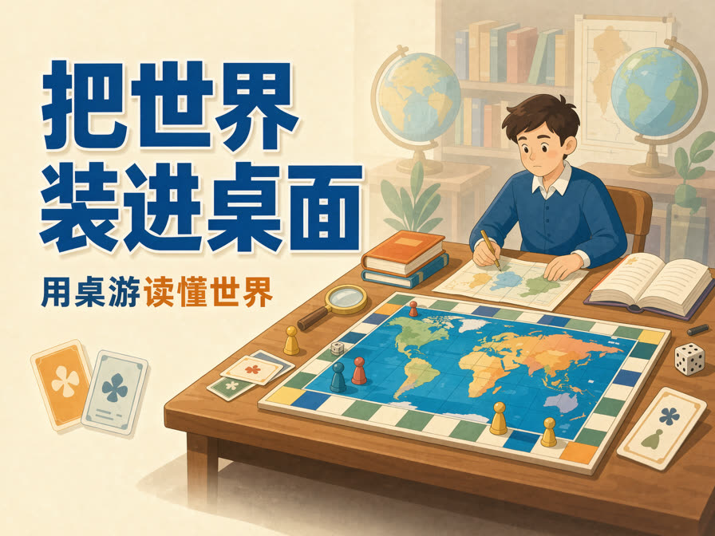

作为一个桌游新入门玩家，**把世界装进桌面**是我对桌游的感受，**用桌游读懂世界**是我对桌游的使用方法。

<!--more-->

<br/>

## 把世界装进桌面

**任何艺术形式都是对生活的切片与重构。**例如，绘画是对某一时间和空间的二维切片并用画笔进行重构，电影是对一段时间和空间进行切片并用视听语言和剪辑进行重构。

同样，桌游作为一种艺术形式，将世界切片为美术和道具，用规则进行重构，玩家们化身为“米宝”（Meeple，桌游中代表玩家的棋子），遨游在这一方天地，创造了独属于桌游的魅力。

这里有：

* **技能运动会**。在《胡闹运动会》中，我们将派出运动员轮番出场——绊倒别人的香蕉人、吞噬一切的大嘴、独占一格的巨婴等等，在技能四射的磕绊中欢乐赛跑。
* **开心农场**。在《农场主》中，我们化身十七世纪中欧的一户农民，在这里种菜烤面包，建造围栏养猪养牛，去钓鱼和做手工，建造房屋扩大家庭，打造最富有的家园。
* **历史和战争**。《冷战热斗》把整个 20 世纪后半叶折进一张世界地图。分别扮演美国和苏联的领导人，从 1947 打到 1991，十回合，卡牌驱动。110 张事件牌里，每张都对应真实历史：太空竞赛、越南、古巴导弹危机、和平运动、政变、间谍战。 在各国版图投放影响值，抢盟友、稳政权、避免热战失控。让没经历过冷战的人，也能体会那种「没人开战，但处处都是战争」的张力。 
* **合作生存**。在《瘟疫危机》《死亡寒冬》《灵迹岛》一类合作或半合作桌游里，全员对抗生存危机。
* **推理悬疑**，**组团探险**，**交易谈判**，**太空探索**，**休闲钓鱼**等等等等。

在全球最大的桌游社区 [BoardGameGeek（BGG，即“桌游极客”） ](https://boardgamegeek.com/)中，收录了超过12万款桌游。

```
这里有许多类型的桌游，包括成千上万种你可能从未在商店见过的游戏！我们不仅涵盖桌游，还包括骰子游戏、纸牌游戏、铺牌游戏和灵巧游戏。我们有抽象类、经济类游戏、地下城探险、城市建设、外交与谈判、贸易、益智游戏、策略游戏、派对游戏、战争游戏等等。我们涵盖了从轻松奇妙的卡卡颂到严肃沉重的帝国建设风格《暮光帝国：第四版》。也存在像大富翁这样知名的游戏，尽管你会发现几乎所有用户都更喜欢那些自大富翁首次发布以来，游戏玩法和组件质量都有进步的现代游戏。
—— [欢迎来到BoardGameGeek |维基 |桌游极客](https://boardgamegeek.com/wiki/page/Welcome_to_BoardGameGeek)
```

如果世界是无限的，那么桌面就是无限的。在这里你可以体验到你想要的一切，如果暂时没有，你当然可以创造你自己的游戏，现如今，每年有超过 7000 款新游戏面世。桌游还是一个较新的艺术门类，这个世界不仅可以让无限的人加入，也永远不怕被填满。

<br/>

## 用桌游读懂世界

大部分人小时候或多或少都接触过象棋、围棋、军棋、大富翁等游戏，这些都属于桌游。这中间既有象棋、围棋的多回合布局和运营，也有军棋的心理博弈与试探，还有大富翁的财富累积效应。值得注意的是，这些都不是游戏规则告诉我们的，而是我们玩游戏的过程中感受到、思考到的，我们乐此不疲的思考复盘，一遍遍的开启新的对局。

这些游戏“益智”的部分，被游戏设计者巧妙的放入了游戏内，其中的一个关键是使用适当的抽象把世界切片。

比如《卡坦岛》中，通过地图片上的点数和 2 个 6 面骰，把地型表示为不同概率的自然资源，又通过占领据点的方式抢夺这些资源，巧妙的模拟了依靠自然资源和地理位置发展的社会情形。

在《快餐连锁大亨》中，广告在夜晚发挥效果促使附近的居民添加他们的购买清单，更是对现代生活的精确切片，以至于每次看到洗脑广告都会想到《快餐连锁大亨》。

一个设计良好的游戏，不仅可以通过对世界的精准切片保留生活中的智慧，还可以通过对奖励的调整以传递良好的价值观。

在传统的游戏中大多是单一的奖励，而现代桌游往往设计了多条取胜路径，形成一个多元和丰富的世界。例如，在《卡坦岛》中升级城市、最强军队+分卡、港口+内陆等等不同的发展路线保证了每个人的游戏体验，在《农场主》中，不仅家庭住宅、获得的设施、养的动物都可以增加“豪华程度”，更是从开始便会抽取职业卡以分化发展路线。

这种寓教于乐的方式，是我觉得最好的学习方式。

更进一步，我相信掌握桌游化世界的方法，对读懂世界有着十分积极的意义，也就是对事物的良好抽象能力。在人生的游戏中，抽象手中的资源（时间、金钱、精力体力等），制定终局目标（财富值、科研成果、企业家、脱口秀大王等），分配行动点，寻找最优解的桌游思路，不仅可以发挥一定的指引作用，还可以助我们找到问题的答案。

<br/>

## 终

以上就是我目前对桌游的感受，挂一漏万，先说两点，剩下的 19998 点我们下次再说吧。
